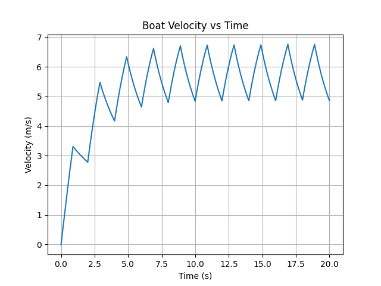
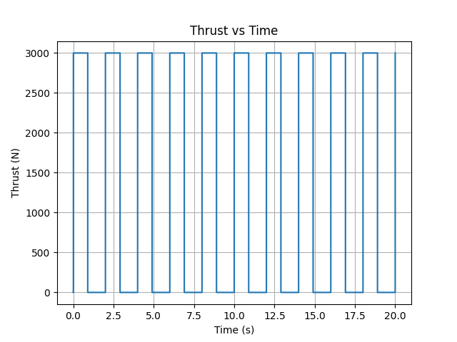
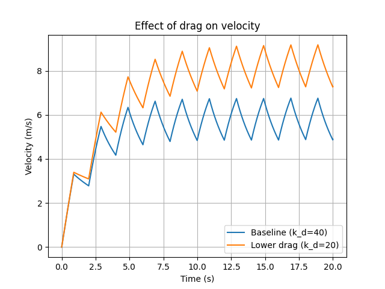
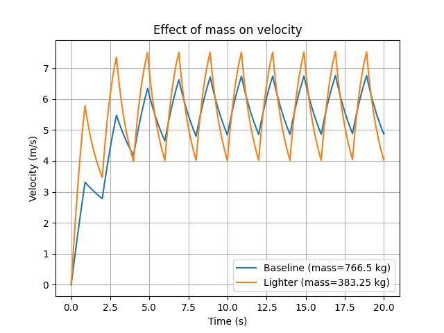
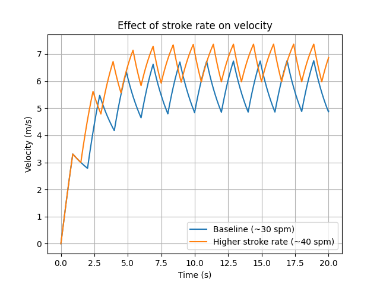

# Rowing research

Public website: https://gabrielcirker.github.io/rowing-research/

The site contains an inline 12-page report reader, current research files, and a searchable 93-file current/archived catalog.

Original manuscript affiliation: St. John’s University (2025). Revision affiliation: University of Michigan, Ann Arbor (2026), shown as a smaller, explicitly labeled update on the website. Contact: gcirker@umich.edu.

This is a fresh publication repository, separate from the private research history. The JURPA-format archival PDF has its historical contact email removed and is explicitly labeled as a public copy. Other research originals are preserved. See `PUBLICATION.md` and the website archive coverage note.

# Simulating Mechanical Energy Transfer in Rowing

This repository contains a physics-based rowing model and analysis tools that simulate boat velocity over repeated strokes and quantify how mechanical energy input is partitioned into drag losses and kinetic energy changes.

## Key Results (20 s simulation)
From `results/rowing_results_summary.txt`:
- Average velocity (last half): 5.785 m/s
- Maximum velocity: 6.759 m/s
- Thrust work on modeled mass: 141175.7 J
- Energy dissipated by drag: 132324.8 J
- Change in kinetic energy: 9167.0 J
- Kinetic energy gain / thrust work: 6.49 %

## Figures
### Boat Velocity vs Time


### Thrust vs Time


### Sensitivity Analyses




## Repo Structure
- `src/` — simulation + analysis code
- `paper/` — LaTeX source + compiled PDF
- `figures/` — plots generated by the model
- `results/` — summary metrics and outputs

## How to Run
```bash
python3 -m venv .venv
source .venv/bin/activate
pip install -r requirements.txt
python src/rowing_model.py
python src/rowing_analysis.py
```

## Model limitations

The last quantity is a startup energy fraction, not rowing efficiency. Thrust work is computed on the modeled mass and does not measure rower or metabolic work. The higher-rate scenario also increases the drive fraction, so it is not a constant-work comparison. The paper includes a timestep convergence check and discusses the model assumptions.

## Research prototypes

`src/multibody_model.py` implements the manuscript's prescribed slide, surge and pitch surrogate; `src/imu_processing.py` reconstructs uniform resampling and a small-angle complementary filter. These are not measurements or empirical validation. The IMU functions assume positive vertical gravity at rest; the manuscript's synthetic sensor uses the opposite sign and requires reconciliation. The candidate stroke-peak detector and state-based fitting prototype are tested on synthetic inputs. A synthetic planar IMU and relative per-record stroke index are included as prototypes; the original figures are not reproduced. The synthetic sensor adopts positive vertical gravity at rest to match the filter. The fit uses modeled speed and pitch rate, not raw IMU data; noiseless self-recovery does not establish real-world identifiability. Run the numerical checks with `python -m unittest discover -s tests -v`.

Run `python src/fit_robustness_demo.py` for one fixed-seed synthetic noise and drag-mismatch example. The index is standardized within a recording and is not a validated absolute risk measure.

The adapted synthetic figures can be regenerated with `python src/appendix_figure_demo.py`. They use a different integrator and gravity convention from the manuscript listing and are not exact reproductions.
